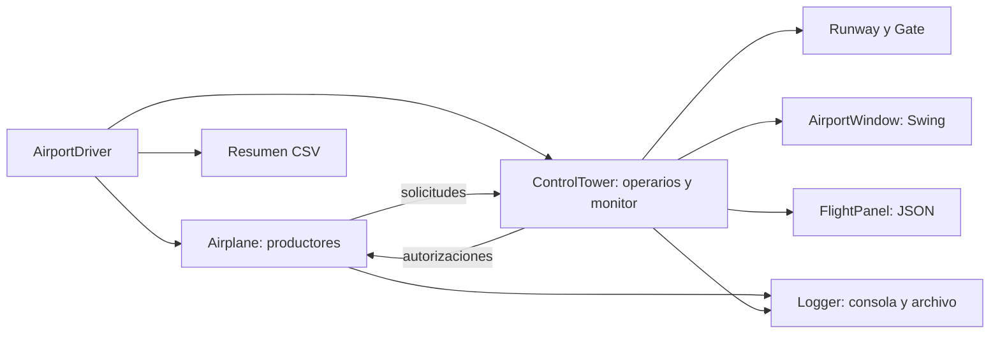

# AERON · Simulador aeroportuario concurrente

[](https://github.com/amonterooq/proyecto_aeron/actions/workflows/ci.yml)

**Coordinación de vuelos y recursos limitados mediante hilos y monitores Java.**

AERON simula el ciclo de aterrizaje, embarque y despegue de varios aviones que compiten por pistas y puertas. Una torre de control coordina las solicitudes mediante operarios concurrentes, una cola de trabajo y una lista de espera. Incluye una interfaz Swing y registros de ejecución en LOG, JSON y CSV.

Proyecto académico de **Programación Concurrente y Distribuida**, desarrollado por **Ana Montero Preciado**.

## Qué demuestra

- **Programación concurrente:** hilos productores y consumidores, exclusión mutua con `synchronized` y espera condicionada con `wait` / `notifyAll`.
- **Gestión de recursos:** reserva conjunta de pista y puerta para aterrizar, y reactivación de solicitudes al liberar recursos.
- **Diseño modular:** separación por paquetes de entidades, coordinación, recursos, interfaz y utilidades.
- **Observabilidad:** trazas con hora e hilo, estado de vuelos en JSON y ranking de tiempos por avión en CSV.
- **Validación reproducible:** seis escenarios sin interfaz gráfica y comprobaciones automatizadas en GitHub Actions.

## Inicio rápido

Requisitos: **JDK 21** (`java` y `javac`) y un escritorio gráfico para la interfaz. No requiere librerías externas, base de datos ni servicios. Las pruebas pueden ejecutarse sin pantalla.

```bash
git clone https://github.com/amonterooq/proyecto_aeron.git
cd proyecto_aeron
```

En Windows, desde PowerShell:

```powershell
./scripts/aeron.ps1 build
./scripts/aeron.ps1 run
```

Si la política de PowerShell bloquea un script descargado, puede ejecutarse para ese proceso con `powershell -ExecutionPolicy Bypass -File ./scripts/aeron.ps1 run`. Si hay varios JDK instalados, configura `JAVA_HOME` con la carpeta del JDK 21.

En Linux o macOS, desde Bash:

```bash
bash scripts/aeron.sh build
bash scripts/aeron.sh run
```

Los scripts compilan desde `src/` a `build/classes/` antes de ejecutar. La aplicación comienza en `aeronpcd.driver.AirportDriver`.

## Demo guiada

1. Ejecuta la aplicación y selecciona `CONCURRENTE`.
2. Configura **5 aviones, 1 pista, 1 puerta y 2 operarios** para observar la contención.
3. Observa la cola y los cambios de ocupación de pistas y puertas en la ventana.
4. Al terminar, consulta los tres archivos asociados a la ejecución en `logs/concurrente/`.
5. Repite con `SECUENCIAL` y la misma cantidad de aviones y recursos para explorar el efecto de solapar vuelos.

En modo secuencial se completa un avión antes de iniciar el siguiente; la torre sigue usando un operario en su propio hilo. En modo concurrente cada avión se ejecuta como hilo independiente. El panel izquierdo muestra los eventos que la torre envía a la ventana; el log de archivo y la consola contienen las trazas completas.

| Parámetro | Intervalo admitido en la interfaz |
| --- | --- |
| Aviones | 1–100 |
| Pistas | 1–10 |
| Puertas | 1–20 |
| Operarios | 1–20; uno en modo secuencial |

## Arquitectura



El aterrizaje reserva pista y puerta dentro del monitor de la torre. Si no hay ambas, la solicitud pasa a una lista de espera sin retener recursos parciales. Los detalles de sincronización, decisiones y límites están en [Arquitectura](docs/ARCHITECTURE.md).

## Pruebas

```powershell
./scripts/aeron.ps1 test
```

```bash
bash scripts/aeron.sh test
```

La batería tarda varios minutos por las esperas simuladas. Finaliza con error si supera cinco minutos, un vuelo no termina, quedan recursos ocupados o faltan resultados. Consulta [Validación](docs/TESTING.md) para conocer escenarios y alcance. GitHub Actions ejecuta la batería en Windows y Linux y conserva los resultados como artefactos.

## Estructura

```text
src/aeronpcd/
  driver/       Configuración y orquestación
  model/        Aviones, solicitudes y estados
  tower/        Coordinación y asignación de recursos
  resources/    Pistas y puertas
  gui/          Interfaz Swing
  util/         Registro, panel JSON y representación del estado
  test/         Batería de integración sin GUI
scripts/        Compilación, ejecución y pruebas
docs/           Arquitectura, validación y presentación profesional
.github/        Integración continua
AERON.md        Memoria académica original con aclaraciones
```

`build/`, `bin/`, `logs/` y `test/` son salidas locales y no se versionan. Las trazas antiguas se conservan en el historial del repositorio; no se presentan como mediciones actuales.

## Resultados y límites

Cada ejecución de la interfaz genera un `.log`, un `_board.json` y un `_resumen.csv` con el mismo identificador. El CSV contiene `Avión;Tiempo total (ms);Ranking`. El tiempo por avión incluye sus esperas; no equivale a la duración global de la simulación.

Los tiempos incluyen retardos artificiales y aleatoriedad sin semilla configurable. No se afirma una aceleración cuantificada ni ausencia formal de inanición. El proyecto modela coordinación dentro de una JVM; no implementa comunicaciones de red ni un sistema distribuido de control aéreo. Véanse las [limitaciones técnicas](docs/ARCHITECTURE.md#limitaciones-y-evolución).

## Documentación y autoría

- [Arquitectura y decisiones](docs/ARCHITECTURE.md)
- [Pruebas y reproducción](docs/TESTING.md)
- [Guía de contribución](CONTRIBUTING.md)
- [Memoria académica](AERON.md)

**Autora:** Ana Montero Preciado · [GitHub](https://github.com/amonterooq)

No se ha añadido una licencia de reutilización en esta preparación. La visibilidad pública permite consultar el proyecto; no sustituye una licencia expresa.
